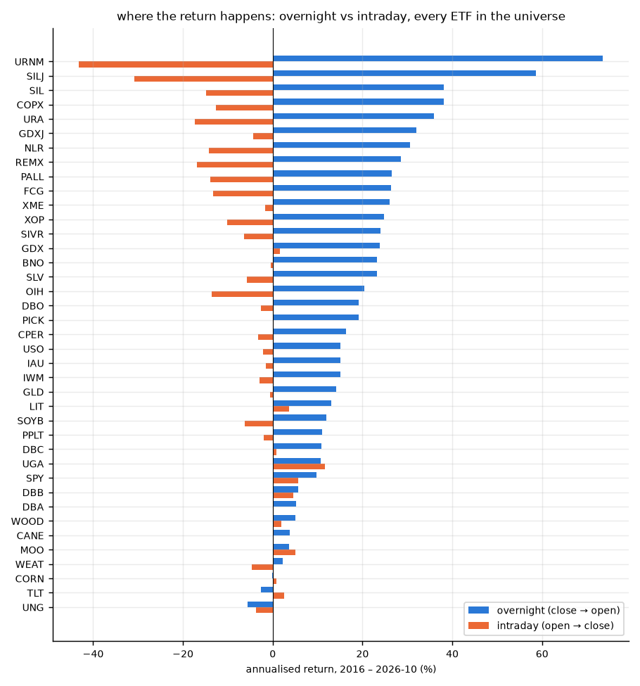
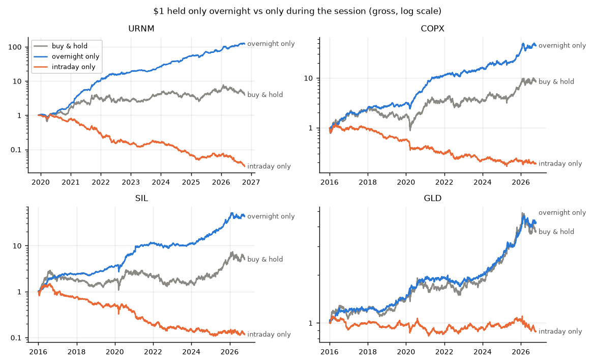
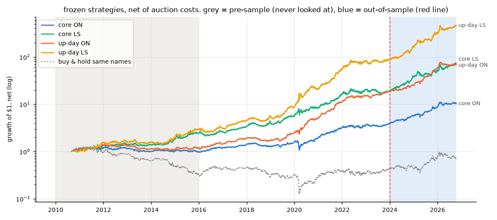
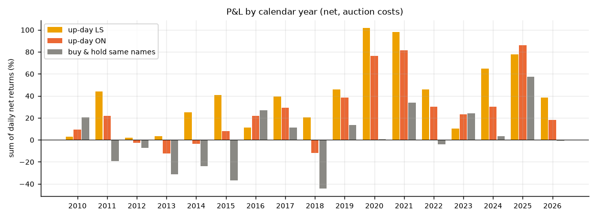
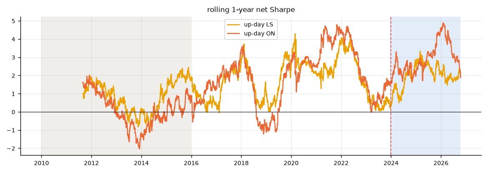
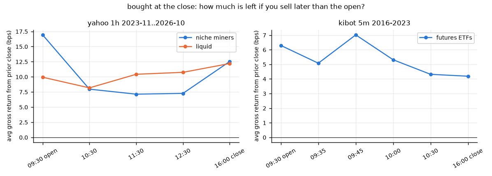
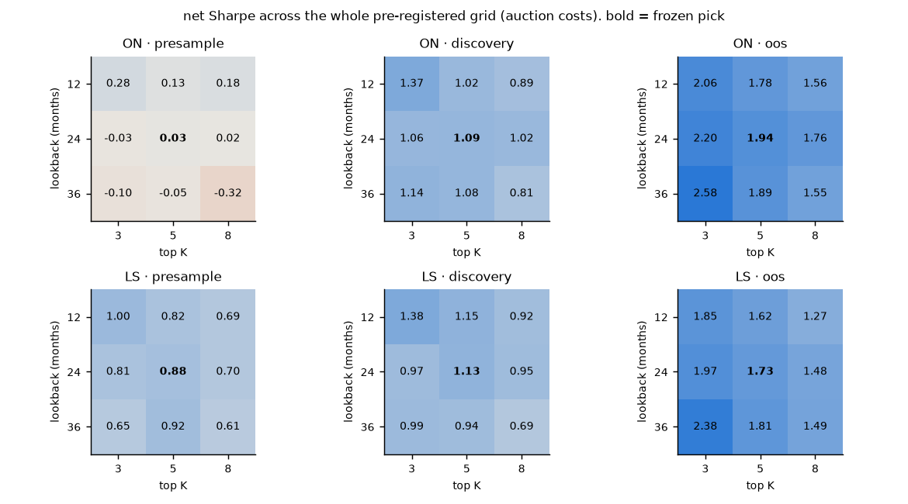
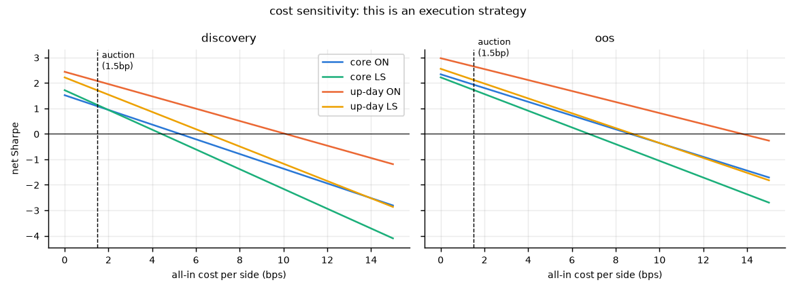
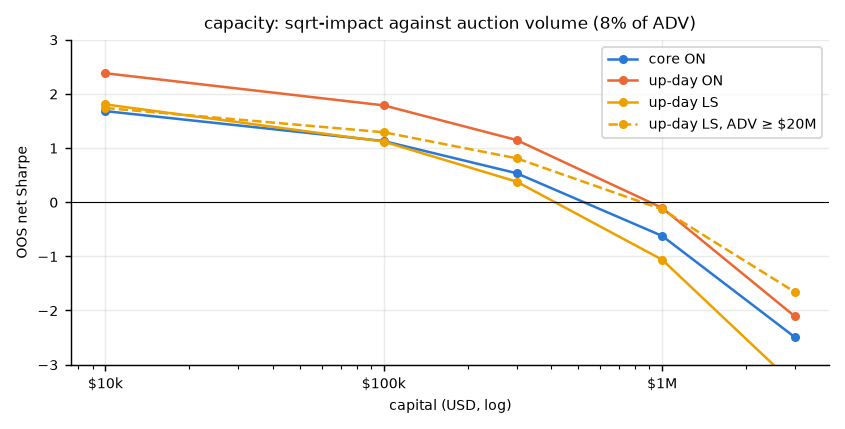
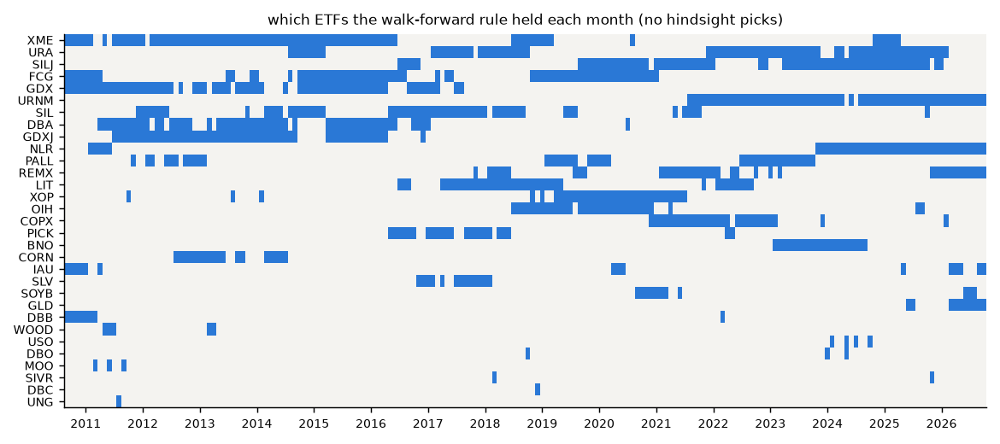

# Overnight Drift in Commodity-Miner ETFs

**TL;DR:** niche commodity ETFs (uranium, silver/gold juniors, copper, rare earths) make basically all their money **overnight** and lose money **during the session**. URNM since 2020: +74%/yr close→open, −43%/yr open→close. the trade: every month pick the 5 ETFs where that gap has been strongest over the last 24 months. each day, buy the ones that closed up in the **closing auction**, sell in the **next opening auction**, and short them open→close with the same money. no waiting for a signal, the capital works every day. net Sharpe **1.0 / 1.7 / 2.1** across 2011–15 (never looked at), 2016–23 (where params were picked) and 2024–26 (out of sample). green in all 17 calendar years. catch: it only works through the auctions (cross the spread and it's dead), it tops out around **$100–300k**, the short leg needs a margin account with $25k+ (pattern day trader rule), and in 2024–26 uranium carried most of it.

---

## the effect



the top of that chart is all miner/producer equity ETFs: URNM, SILJ, SIL, COPX, URA, GDXJ, NLR, REMX. futures ETFs (USO, UNG, CORN…) barely show it. my best guess at why: part of what these ETFs hold trades in Sydney, London and Kazakhstan while the US ETF is closed, so it catches up at the open. on top of that, retail buying in attention-grabbing names tends to hit at the open, which pushes opens up (Berkman et al. 2012, "Paying Attention: Overnight Returns and the Hidden Cost of Buying at the Open").



## the rule

1. **universe:** 36 commodity-linked US ETFs, chosen for being commodity exposure, not for their results (`config/overnight.yaml`). needs ≥$2M median daily volume.
2. **pick (1st of each month):** rank by trailing 24-month Sharpe of (overnight − intraday) and keep the top 5 with a positive score. weight by inverse overnight vol.
3. **each day:** of those 5, the ones that are up open→close get the overnight money, renormalised (cash if none are up). **MOC buy → MOO sell.**
4. **LS leg:** short all 5 from the open to the close with the same capital. gross exposure is never above 1x.

`up-day LS` = all four steps. `core` skips step 3; `ON` skips step 4.

## in-sample / out-of-sample

| period | role | touched? |
|---|---|---|
| 2010–2015 | **pre-sample** | never looked at before the freeze |
| 2016–2023 | discovery | the only data used to choose lookback, K, and the up-day filter |
| 2024 – 2026-10 | out-of-sample | first run after the freeze |

the ETF picks are walk-forward (month m only sees data before m), so URNM etc. are never hand-picked. full disclosure: this idea came out of a sweep that saw 2024–26 per-ticker numbers, so **2010–15 is the cleanest test**, not 2024–26 (see `docs/OVERNIGHT_DECISIONS.md`).

## results (net, auction costs)

| strategy | 2011–15 pre-sample | 2016–23 discovery | 2024–26 OOS | max DD | years green |
|---|---|---|---|---|---|
| **up-day LS** | **1.04** (22%/yr) | **1.71** (53%/yr) | **2.12** (83%/yr) | −27% | **17/17** |
| up-day ON | 0.31 | 2.08 | 2.65 | −24% | 13/17 |
| core LS | 0.93 | 1.13 | 1.73 | −28% | |
| core ON | 0.03 | 1.09 | 1.94 | −37% | |
| buy & hold same names | −0.80 | 0.26 | 0.68 | | 9/17 |




- the long-only versions **fail the pre-sample**. 2011–15 was a commodity bear market and buying overnight still meant owning miners. the LS hedge is what makes it work in every regime, so up-day LS is the headline.
- OOS up-day LS: bootstrap 95% CI on Sharpe **[1.15, 3.22]**, deflated Sharpe 0.61 after counting 200 trials.



## is the money just sitting there?

no, and this is the big difference from SPUT/YCA, which only trades when the z-score stretches past ±1. here:

- the overnight leg is invested **73–83% of nights** (the rest are nights where none of the 5 closed up)
- the LS short leg runs **every** trading day
- the **same dollar** is long overnight and short intraday, so you never need more than 1x gross

## making it better

| change | result | kept? |
|---|---|---|
| auction execution (MOC/MOO) vs crossing the spread | the whole edge. crossing the spread: Sharpe −2.2 / −1.6 / 0.4 | **yes, mandatory** |
| up-day filter (only hold names that closed up) | discovery 1.13 → 1.71 (LS). down-day control: 0.56 | **yes** |
| LS: short the same names intraday | the only version positive in the pre-sample | **yes** |
| higher liquidity floor (ADV ≥ $20M) | slightly lower Sharpe (0.65 / 1.01 / 1.94) but ~2× the capacity | optional, if you're >$100k |
| sell later than the open | niche names give back half the overnight gain by 10:30 | no, sell in the open auction |
| skip weekends | +0.1 Sharpe on ON only, nothing on LS | no |
| futures/physical ETFs only | ~0 Sharpe | no, it's a miners effect |



the up-day signal uses the close in the backtest. live, you'd use the price a few minutes before the MOC cutoff. checked on KIBOT 5-min data for 2016–23: the 15:45 sign agrees with the close sign on ~95% of days, and the after-up/after-down gap is still there.

## then i tried to kill it

| up-day LS, Sharpe | pre | disc | OOS |
|---|---|---|---|
| as frozen | 0.98 | 1.71 | 2.12 |
| best 10 days removed | 0.59 | 1.43 | 1.47 |
| no uranium (URA/URNM/NLR) | 0.98 | 1.44 | **0.29** |
| miners/equity ETFs only | 1.06 | 1.93 | 2.21 |
| futures/physical only | −0.82 | −0.03 | −0.29 |
| ADV ≥ $20M | 0.65 | 1.01 | 1.94 |

(the pre-sample number here counts the empty months before the first pick, hence 0.98 vs 1.04.)






what landed:

- **costs are everything.** breakeven is 6.5–8.8 bp/side for up-day LS. auctions cost ~1.5 bp, crossing the spread costs 2–20 bp + commission on these names.
- **capacity is tiny.** with sqrt impact against auction volume (assumed 4% of ADV per auction, conservative), Sharpe falls to ~1.1 at $100k, ~0.4 at $300k, and below zero at $1M. the ADV ≥ $20M version holds 0.8 at $300k.
- **2024–26 is a uranium story.** take out URA/URNM/NLR and OOS LS drops to 0.29. it held up without uranium in 2011–23 (0.98 / 1.44), so it's not *only* uranium, but recently it mostly is.
- the whole grid is positive in discovery and OOS for both variants (fig above), so it's not one lucky parameter cell. ON in the pre-sample is ~0 across the whole grid.

## verdict

- **up-day LS is the one.** positive in all three periods, including six years nobody looked at, and in all 17 calendar years. Sharpe ~1.6 over 2011–2026.
- **it's an execution strategy.** if your broker can't do MOC/MOO on Arca-listed ETFs, don't bother.
- **practical size: $25k–$300k.** under $25k the intraday short runs into the pattern day trader rule (check your broker, FINRA has been revising it), so run the ON-only version (and accept it can go flat for years like 2012–14). above ~$300k impact eats it.
- **you need intraday short locates** for SILJ/URNM-type names. no overnight borrow fee because the short is flat by the close, but the locate has to be there.
- status: paper trade first. the up-day filter was found in 2016–23 and passed both untouched periods, but it's one more degree of freedom.

## repro

```
uv sync
make overnight     # ingest (yahoo) → timing tests → grid/backtests/robustness/figures
```

optional: `KIBOT_DIR=/path/to/KIBOT make overnight` adds the 2016–23 5-min exit-timing panel (licensed data, not committed).

| file | what |
|---|---|
| `config/overnight.yaml` | universe, periods, grid, costs, the frozen rule |
| `docs/OVERNIGHT_DECISIONS.md` | every call in order, incl. the lookahead bug i caught in myself |
| `src/sput_research/overnight/` | data split + walk-forward strategy |
| `tests/test_overnight.py` | point-in-time tests (poisoned future data must not change picks/signals) |
| `reports/overnight/tables/` | every number above |

## the fine print

- prices are yahoo daily OHLC. checked against KIBOT 5-min for 10 ETFs over 2016–23: overnight returns correlate 0.994–0.999.
- "open" and "close" are the official auction prints. the backtest assumes you get them plus 1.5 bp. thin auctions can move against you, which is what the capacity curve models.
- spreads come from a tiered $ADV table, not measured quotes. a daily-bar spread estimator was tried and thrown out (it put GLD at 30 bp).
- days with stale or zero-volume bars are not traded (CPER/CANE/NLR lose 12–23% of days to this).
- no taxes. every overnight hold is a short-term gain.
