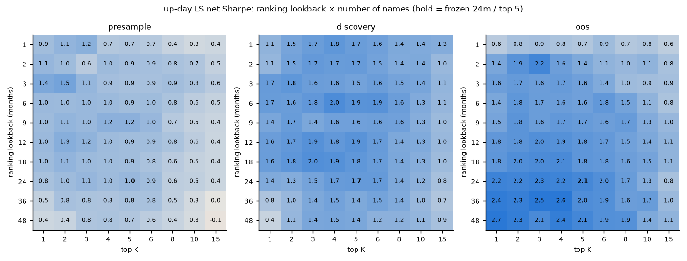
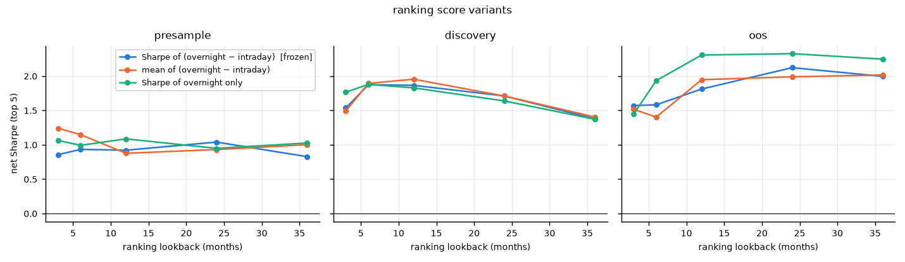
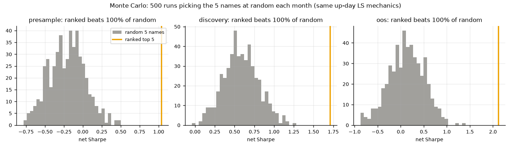
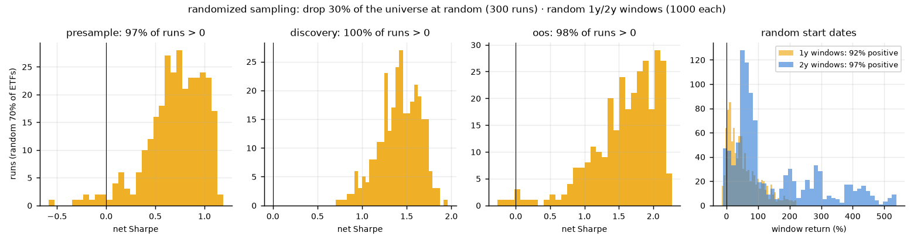
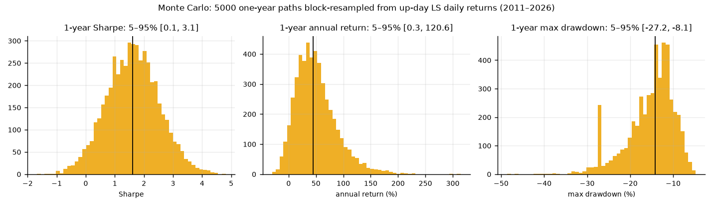
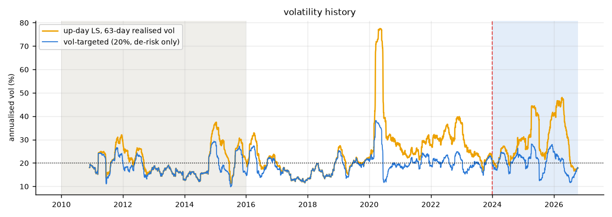
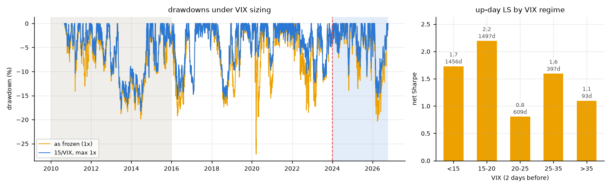
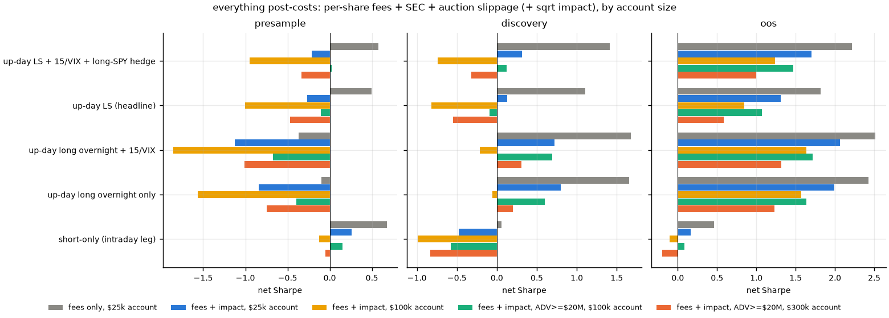

# Overnight Drift in Commodity-Miner ETFs

> the original SPUT/YCA pair trade writeup now lives in [SPUT_YCA.md](SPUT_YCA.md).

**TL;DR:** niche commodity ETFs (uranium, silver/gold juniors, copper, rare earths) make basically all their money **overnight** and lose money **during the session**. URNM since 2020: +74%/yr close→open, −43%/yr open→close. the trade: every month pick the 5 ETFs where that gap has been strongest over the last 24 months. buy the ones that closed up in the **closing auction (MOC)**, sell in the **next opening auction (MOO)**, and short them open→close with the same money. at a flat 1.5 bp per trade it's Sharpe **1.0 / 1.7 / 2.1** across 2011–15 (never looked at), 2016–23 (where params were picked) and 2024–26 (out of sample). **after realistic costs** (per-share fees, SEC fee, auction slippage, market impact) most of the pre-2020 edge goes away, because the ETFs it held back then traded only ~$5M a day. in 2024–26, with those ETFs now 10–20× bigger, it still works: OOS Sharpe ~**1.2–2.1** for a $25k–$100k account. it needs auction orders, a margin account, and in 2024–26 uranium carried most of it.

## the best strats (short version)

net Sharpe for 2011–15 / 2016–23 / 2024–26. "post-cost" = per-share fees + SEC fee + 1 bp auction slippage. "+ impact" adds sqrt market impact against auction volume (details in [post-costs](#moomoc-check-and-everything-post-costs)).

| rank | strategy | flat 1.5 bp | post-cost, $25k | 2024–26 + impact, $25k / $100k | use it when |
|---|---|---|---|---|---|
| **1** | **up-day long/short + 15/VIX sizing + small long-SPY beta hedge** | 1.18 / 1.88 / 2.36* | **0.58 / 1.41 / 2.21** | **1.70 / 1.24** | default if you can short. only one positive in all 3 periods after costs |
| **2** | **up-day long overnight + 15/VIX** | — | −0.37 / 1.68 / 2.51 | **2.06 / 1.64** | no shorting, no pattern-day-trader issue, half the trading. loses in commodity bear markets (2011–15) |
| 3 | up-day long/short (frozen headline, no overlays) | 1.04 / 1.71 / 2.12 | 0.50 / 1.10 / 1.82 | 1.31 / 0.84 | the overlays help after costs, so use #1 instead |
| 4 | short-only (intraday leg alone) | 0.90 / 0.37 / 0.58 | 0.68 / 0.06 / 0.46 | 0.16 / −0.10 | don't. the edge is the overnight long |
| — | everything else | — | — | — | trend, intraday momentum, EIA windows, pairs (USO/BNO, GLD/SLV, PPLT/PALL), roll timing, 5-min lead-lag: inconsistent or too small to beat costs |

\* #1 at flat cost uses the beta hedge only, without VIX sizing. VIX sizing and the SPY hedge were found **after** OOS was known, so treat #1 and #2 as "promising, paper trade", not validated.

**rules:**
- **MOO/MOC orders only.** the price moves 14–28 bp in the first minute after the open in these ETFs, about the whole nightly edge (~17 bp). miss the auction and you're flipping a coin
- **size $25k–$100k**, up to ~$300k with an ADV ≥ $20M filter (OOS Sharpe 1.0–1.3 there). beyond that impact eats it
- #1 needs a margin account and intraday short locates (URNM, SILJ)
- 2024–26 was carried by uranium (without it, OOS Sharpe 0.29 even at flat cost)
- paper trade first

**risk, #1 post-cost at $25k (2011–2026):** CAGR 27%, vol 19%, Sharpe 1.33, max DD **−25%**, green 13/17 years. 2024–26 alone: 69%/yr.

---

## the effect


the top of that chart is all miner/producer equity ETFs: URNM, SILJ, SIL, COPX, URA, GDXJ, NLR, REMX. futures ETFs (USO, UNG, CORN…) barely show it. my best guess at why: part of what these ETFs hold trades in Sydney, London and Kazakhstan while the US ETF is closed, so it catches up at the open. on top of that, retail buying in attention-grabbing names tends to hit at the open, which pushes opens up (Berkman et al. 2012, "Paying Attention: Overnight Returns and the Hidden Cost of Buying at the Open").


## the rule

1. **universe:** 36 commodity-linked US ETFs, chosen for being commodity exposure, not for their results (`config/overnight.yaml`). needs ≥$2M median daily volume.
2. **pick (1st of each month):** rank by trailing 24-month Sharpe of (overnight − intraday) and keep the top 5 with a positive score. weight by inverse overnight vol.
3. **each day:** of those 5, the ones that are up open→close get the overnight money, renormalised (cash if none are up). **MOC buy → MOO sell.**
4. **LS leg:** short all 5 from the open to the close with the same capital. gross exposure is never above 1x.

`up-day LS` = all four steps. `core` skips step 3; `ON` skips step 4.

## in-sample / out-of-sample

| period | role | touched? |
|---|---|---|
| 2010–2015 | **pre-sample** | never looked at before the freeze |
| 2016–2023 | discovery | the only data used to choose lookback, K, and the up-day filter |
| 2024 – 2026-10 | out-of-sample | first run after the freeze |

the ETF picks are walk-forward (month m only sees data before m), so URNM etc. are never hand-picked. full disclosure: this idea came out of a sweep that saw 2024–26 per-ticker numbers, so **2010–15 is the cleanest test**, not 2024–26 (see `docs/OVERNIGHT_DECISIONS.md`).

## results (flat 1.5 bp auction cost, before the realistic post-cost run)

| strategy | 2011–15 pre-sample | 2016–23 discovery | 2024–26 OOS | max DD | years green |
|---|---|---|---|---|---|
| **up-day LS** | **1.04** (22%/yr) | **1.71** (53%/yr) | **2.12** (83%/yr) | −27% | **17/17** |
| up-day ON | 0.31 | 2.08 | 2.65 | −24% | 13/17 |
| core LS | 0.93 | 1.13 | 1.73 | −28% | |
| core ON | 0.03 | 1.09 | 1.94 | −37% | |
| buy & hold same names | −0.80 | 0.26 | 0.68 | | 9/17 |


- the long-only versions **fail the pre-sample**. 2011–15 was a commodity bear market and buying overnight still meant owning miners. the LS hedge is what makes it work in every regime, so up-day LS is the headline.
- OOS up-day LS: bootstrap 95% CI on Sharpe **[1.15, 3.22]**, deflated Sharpe 0.61 after counting 200 trials.


## is the money just sitting there?

no, and this is the big difference from SPUT/YCA, which only trades when the z-score stretches past ±1. here:

- the overnight leg is invested **73–83% of nights** (the rest are nights where none of the 5 closed up)
- the LS short leg runs **every** trading day
- the **same dollar** is long overnight and short intraday, so you never need more than 1x gross

## making it better

| change | result | kept? |
|---|---|---|
| auction execution (MOC/MOO) vs crossing the spread | the whole edge. crossing the spread: Sharpe −2.2 / −1.6 / 0.4 | **yes, mandatory** |
| up-day filter (only hold names that closed up) | discovery 1.13 → 1.71 (LS). down-day control: 0.56 | **yes** |
| LS: short the same names intraday | the only version positive in the pre-sample | **yes** |
| higher liquidity floor (ADV ≥ $20M) | slightly lower Sharpe (0.65 / 1.01 / 1.94) but ~2× the capacity | optional, if you're >$100k |
| sell later than the open | niche names give back half the overnight gain by 10:30 | no, sell in the open auction |
| skip weekends | +0.1 Sharpe on ON only, nothing on LS | no |
| futures/physical ETFs only | ~0 Sharpe | no, it's a miners effect |


the up-day signal uses the close in the backtest. live, you'd use the price a few minutes before the MOC cutoff. checked on KIBOT 5-min data for 2016–23: the 15:45 sign agrees with the close sign on ~95% of days, and the after-up/after-down gap is still there.

## variations, monte carlo, risk overlays, hedging

all of this was run **after** the rule was frozen, so it's sensitivity analysis. nothing here re-picks the rule on 2024–26.

**ranking window × number of names.** 90 combos, from 1 month (~21 days) to 48 months and from top 1 to top 15:



- every combo is positive in 2016–23 and 2024–26, and 89/90 in the pre-sample. it's a plateau, not a lucky cell
- 6–18 months with 2–6 names is the most balanced. 24m/top 5 is fine
- 1–3 month windows (~60 days) work early but are weaker OOS (~0.6–1.6). 36–48 months are weak early but best OOS (uranium stayed on top for years)
- 10–15 names dilutes it. blending the 6+12+24 month rankings (~8 names) is also worse: 0.86 / 1.94 / 1.84
- other ranking scores (raw mean gap, overnight-only Sharpe) land in the same place, nothing better



**monte carlo / randomized sampling:**

| test | result |
|---|---|
| pick the 5 ETFs **at random** each month (500 runs, same mechanics) | the ranked version beats **100%** of them in all 3 periods. random median Sharpe −0.20 / 0.57 / 0.13. **the ranking is the edge**, the close→open mechanics alone aren't |
| drop a **random 30% of the universe** (300 runs) | positive in 97% / 100% / 98% of runs. median 0.74 / 1.43 / 1.68. runs without URA+URNM: OOS median 1.05 |
| **random start dates** (1,000 windows each) | 92% of 1-year windows and 97% of 2-year windows made money |
| **block bootstrap** of daily returns (5,000 one-year paths) | 1-year Sharpe 5–95%: [0.1, 3.1]. P(losing year) 5%. P(1-year drawdown worse than −20%) 17%, worse than −30%: 1% |





**volatility.** usually 15–30% a year. spikes: 2020 (46%, ~77% rolling at the peak), 2022 (33%), 2025 (35%).



**VIX sizing** (size = 15/VIX, using the VIX close from 2 days before so it's known before the MOC):

| sizing | Sharpe pre / disc / OOS | max DD full | avg size |
|---|---|---|---|
| as frozen (1x) | 1.04 / 1.71 / 2.12 | −27% | 1.00 |
| **15/VIX, max 1x** | **1.05 / 1.95 / 2.38** | **−18%** | 0.85 |
| 15/VIX, max 2x | 1.07 / 1.97 / 2.40 | −21% | 0.91 |
| half size when VIX > 25 | 0.98 / 1.86 / 2.26 | −20% | 0.94 |
| vol target 20% (de-risk only) | 0.97 / 1.86 / 2.29 | −20% | — |

the strategy still makes money when VIX is high (Sharpe 1.1–1.6 above VIX 25), so VIX sizing doesn't dodge losing regimes. it just cuts the size of the gaps, like March 2020. 15/VIX capped at 1x is the cleanest: it didn't hurt any period.



**hedging / beta.** up-day LS is already **short** the market: beta about −0.25 to −0.37 to SPY and about −0.2 to GDX, because the intraday short leg dominates.

| hedge | Sharpe pre / disc / OOS | max DD full | corr to SPY |
|---|---|---|---|
| none | 1.04 / 1.71 / 2.12 | −27% | −0.16 |
| short SPY overnight (beta-sized) | 0.66 / 1.36 / 1.71 | −34% | −0.33 |
| short GDX overnight (beta-sized) | 0.70 / 1.30 / 1.83 | −29% | −0.23 |
| **beta-neutral: hold long SPY ≈ −beta (avg 0.35x)** | **1.18 / 1.88 / 2.36** | −29% | **0.05** |
| beta-neutral: hold long GDX | 0.95 / 1.91 / 2.60 | −26% | −0.09 |

shorting a hedge overnight is the wrong way round: it adds to the short beta and pays away SPY/GDX's own overnight drift. what helps is the opposite: a small **long SPY** sized to the trailing beta makes it market-neutral (corr ~0) and lifts Sharpe in every period.

## MOO/MOC check and everything post-costs

**are the open/close prices real auction prints?** checked on the last 20 trading days of 1-minute bars (Sep 17 – Oct 14, 2026) for the 15 ETFs it holds most:

| check | result |
|---|---|
| yahoo daily open vs first trade of the day | **identical** (0.0 bp) in all 15. the backtest open *is* the opening print |
| **second source:** Nasdaq.com official open/close vs yahoo, Oct 2016 – Oct 2026 | identical to the cent on **96–100%** of days for 13 of 15 ETFs, and 95% of the rest are within 1 bp. exceptions: NLR closes before 2024 (64–73% identical, still <1 bp) and GDX opens 2024–26 (87%). so the backtest uses the official opening/closing prints |
| actual auction trades with condition codes | not in free daily data. needs tick data (Alpaca free account or Databento). caveat: when a thin ETF's auction doesn't trade, the official open falls back to the first trade |
| price move open → 09:31 | median **14–28 bp** in the miner ETFs (GLD/SPY ~3.5). that's about the whole nightly edge, so **MOO, not "market order right after the open"** |
| official close vs the 15:59 price | median 2–7 bp |
| official close vs 15:50 (MOC cutoff) | median 8–21 bp. why the up-day signal has to use the pre-cutoff price (agrees with the close ~95% of days, see above) |
| per-share fees ($0.005/share) | 0.1–2.3 bp per trade. cheap ETFs cost the most (PALL 2.3, SILJ 1.8, FCG 1.7) |
| closing auction size | **couldn't measure**: yahoo's 1-min volumes don't reconcile with its daily volume. impact assumes each auction = 4% of daily volume, conservative and unverified |

**post-cost model**, per order: `max($0.35, $0.0035/share) + $0.0015/share` (IBKR Pro tiered + exchange/clearing), SEC fee 0.278 bp on every sale and short sale, 1 bp auction slippage, and optionally sqrt impact `0.1 × σ_daily × sqrt(order / auction volume)`. each leg trades twice a day.



| strategy (Sharpe pre / disc / OOS) | fees only, $25k | + impact, $25k | + impact, $100k | + impact, ADV≥$20M, $100k | + impact, ADV≥$20M, $300k |
|---|---|---|---|---|---|
| #1 up-day LS + 15/VIX + long-SPY hedge | 0.58 / 1.41 / 2.21 | −0.21 / 0.31 / 1.70 | −0.95 / −0.74 / 1.24 | 0.02 / 0.12 / 1.47 | −0.33 / −0.32 / 1.00 |
| #2 up-day long overnight + 15/VIX | −0.37 / 1.68 / 2.51 | −1.13 / 0.72 / 2.06 | −1.85 / −0.21 / 1.64 | −0.67 / 0.69 / 1.71 | −1.01 / 0.31 / 1.32 |
| #3 up-day LS (frozen) | 0.50 / 1.10 / 1.82 | −0.27 / 0.13 / 1.31 | −1.01 / −0.82 / 0.84 | −0.10 / −0.09 / 1.07 | −0.47 / −0.55 / 0.59 |
| up-day long overnight only | −0.10 / 1.66 / 2.43 | −0.84 / 0.80 / 2.00 | −1.56 / −0.05 / 1.57 | −0.39 / 0.60 / 1.64 | −0.75 / 0.20 / 1.23 |
| #4 short-only | 0.68 / 0.06 / 0.46 | 0.26 / −0.47 / 0.16 | −0.13 / −0.99 / −0.10 | 0.15 / −0.58 / 0.09 | −0.05 / −0.83 / −0.20 |

how to read it:
- **impact is what kills the old periods**, not fees. the names it held traded a median ~$5M/day in 2016–19 vs ~$80M/day in 2026
- in **2024–26 everything except short-only survives** up to $100k, and to ~$300k with the ADV floor
- the impact model is a guess for auction orders. the truth for a $25k account is probably between the "fees only" and "+ impact" columns

### missing ETFs? (out-of-universe test)

added 25 commodity ETFs that were never in the study (URNJ, NUKZ, COPJ, SETM, RING, GOAU, SGDM, SGDJ, SLVP, SLX, PSLV, PHYS, SPPP, CEF, XLE, XES, IEO, PXJ, GSG, PDBC, KRBN, BATT, CUT, GNR, HAP):

- **the effect shows up in 22 of 25.** strongest in junior/themed miners (overnight−intraday Sharpe: COPJ 3.4, SETM 2.8, NUKZ 2.5, SLVP 2.3, RING 2.0, URNJ 1.9) and the Sprott physical trusts (PSLV 1.75, PHYS 1.56). nothing in broad commodities or carbon (GSG, KRBN). independent confirmation that it's real
- **adding them doesn't improve the strategy.** the ranking grabs the thin new names (COPJ, GOAU, SGDJ trade <$6M/day) and they take 34% of slots. pre-sample at flat cost: 1.04 → 0.72. post-cost it's worse in every case, even with the ADV ≥ $20M floor (#2 at $100k OOS: 1.71 → 1.43)
- **watch list:** PSLV and PHYS (liquid, $130–195M/day), URNJ / NUKZ / COPJ once they're bigger

## then i tried to kill it

| up-day LS, Sharpe | pre | disc | OOS |
|---|---|---|---|
| as frozen | 0.98 | 1.71 | 2.12 |
| best 10 days removed | 0.59 | 1.43 | 1.47 |
| no uranium (URA/URNM/NLR) | 0.98 | 1.44 | **0.29** |
| miners/equity ETFs only | 1.06 | 1.93 | 2.21 |
| futures/physical only | −0.82 | −0.03 | −0.29 |
| ADV ≥ $20M | 0.65 | 1.01 | 1.94 |

(the pre-sample number here counts the empty months before the first pick, hence 0.98 vs 1.04.)


what landed:

- **costs are everything.** breakeven is 6.5–8.8 bp/side for up-day LS. auctions cost ~1.5 bp, crossing the spread costs 2–20 bp + commission on these names.
- **capacity is tiny.** with sqrt impact against auction volume (assumed 4% of ADV per auction, conservative), Sharpe falls to ~1.1 at $100k, ~0.4 at $300k, and below zero at $1M. the ADV ≥ $20M version holds 0.8 at $300k.
- **2024–26 is a uranium story.** take out URA/URNM/NLR and OOS LS drops to 0.29. it held up without uranium in 2011–23 (0.98 / 1.44), so it's not *only* uranium, but recently it mostly is.
- the whole grid is positive in discovery and OOS for both variants (fig above), so it's not one lucky parameter cell. ON in the pre-sample is ~0 across the whole grid.

## verdict

- **the effect is real and was there all along**: positive in all three periods, ranked picks beat 100% of random picks, and it holds across a 90-cell lookback × top-K grid.
- **for most of history it wasn't tradeable at size.** before ~2020 the ETFs it picked traded ~$5M/day. with fees alone it still works at $25k (#1: 0.58 / 1.41), but add modelled impact and the pre-2024 edge is gone even at that size.
- **today it is.** those ETFs now trade $20–120M/day. 2024–26 post-cost OOS Sharpe ~1.2–2.1 at $25k–$100k.
- **it's an execution strategy.** MOO/MOC or nothing.
- **pick #1** (long/short + 15/VIX + long-SPY hedge) if you can short. **pick #2** (long overnight + 15/VIX) if you can't or you're under $25k (pattern day trader rule; check your broker, FINRA has been revising it).
- **status: paper trade.** the overlays were found after OOS was known, and 2024–26 leans on uranium.

## repro

```
uv sync
make overnight     # ingest (yahoo) → timing tests → grid/backtests/robustness/figures
```

optional: `KIBOT_DIR=/path/to/KIBOT make overnight` adds the 2016–23 5-min exit-timing panel (licensed data, not committed).

| file | what |
|---|---|
| `config/overnight.yaml` | universe, periods, grid, costs, the frozen rule |
| `docs/OVERNIGHT_DECISIONS.md` | every call in order, incl. the lookahead bug i caught in myself |
| `src/sput_research/overnight/` | data split + walk-forward strategy |
| `tests/test_overnight.py` | point-in-time tests (poisoned future data must not change picks/signals) |
| `reports/overnight/tables/` | every number above |

## the fine print

- prices are yahoo daily OHLC. checked against KIBOT 5-min for 10 ETFs over 2016–23: overnight returns correlate 0.994–0.999.
- "open" and "close" are the official auction prints. the backtest assumes you get them plus 1.5 bp. thin auctions can move against you, which is what the capacity curve models.
- spreads come from a tiered $ADV table, not measured quotes. a daily-bar spread estimator was tried and thrown out (it put GLD at 30 bp).
- days with stale or zero-volume bars are not traded (CPER/CANE/NLR lose 12–23% of days to this).
- no taxes. every overnight hold is a short-term gain.
