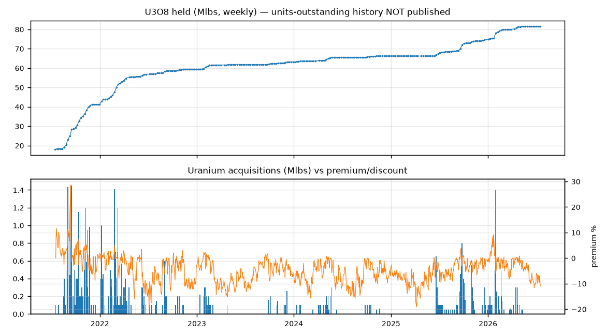
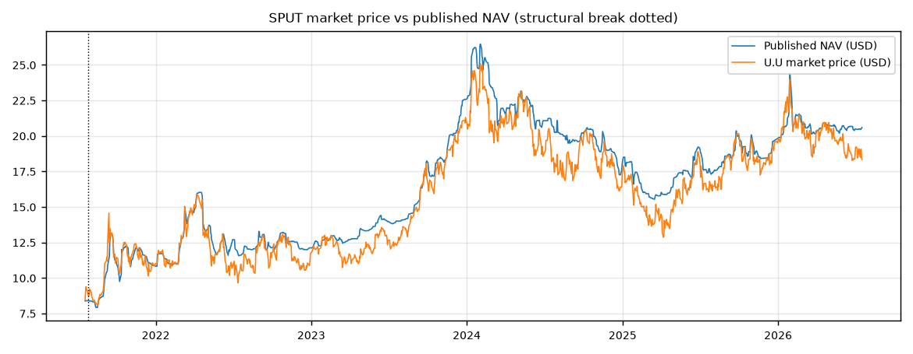
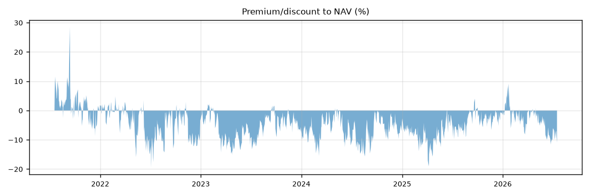
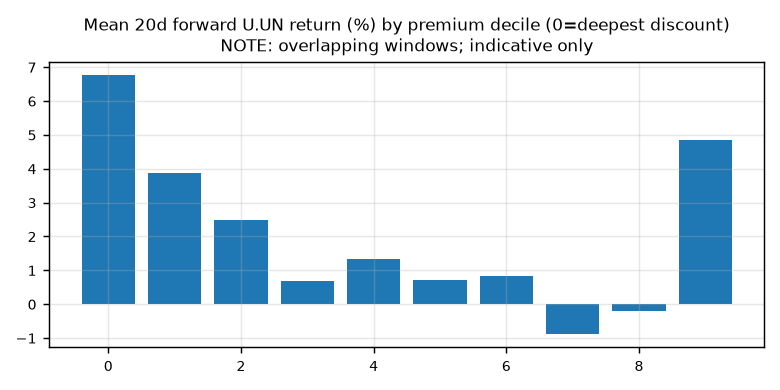
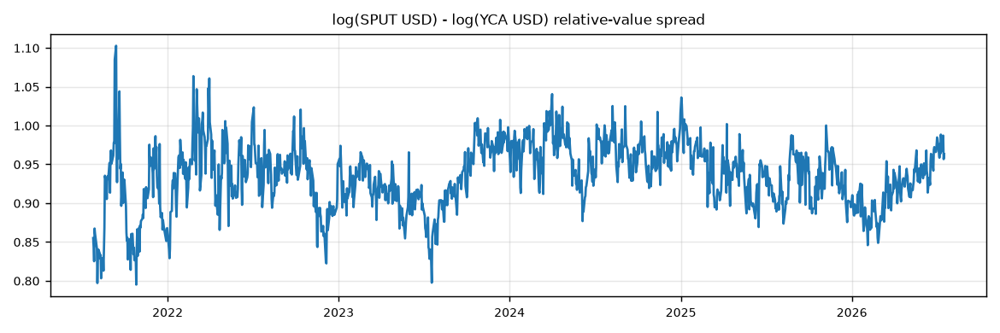
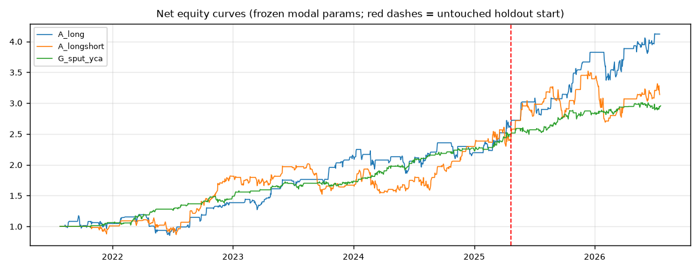
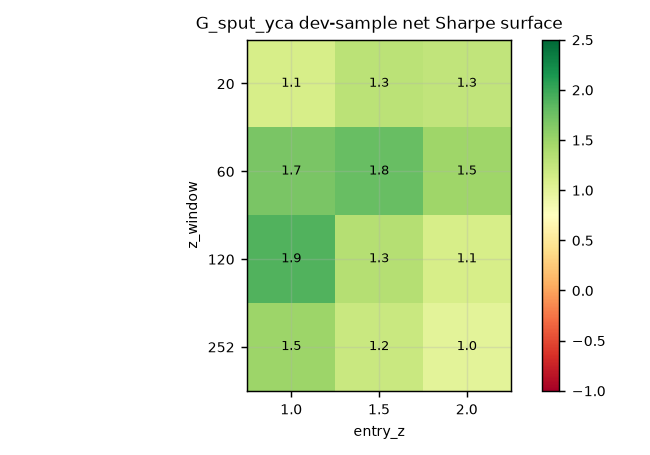
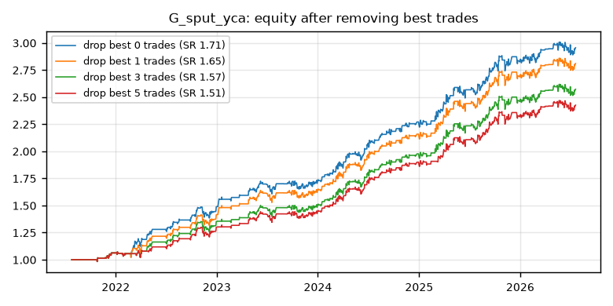
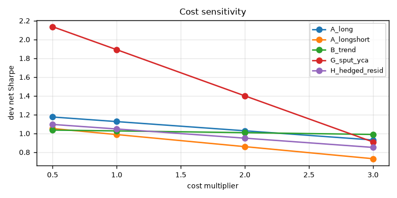
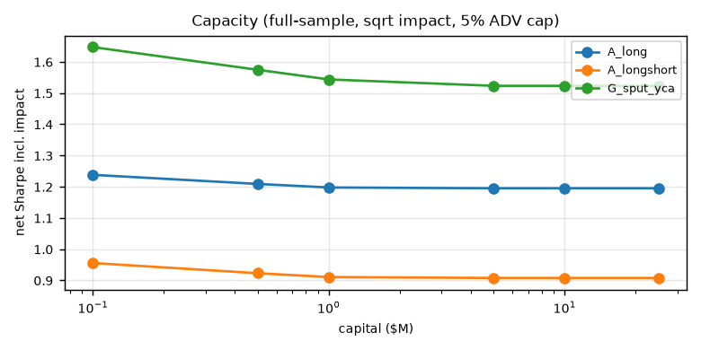

# Nuclear SPUT/YCA Trading

> **second strategy:** [overnight drift in commodity-miner ETFs](OVERNIGHT.md). buy the close auction, sell the open auction, short intraday. net Sharpe 1.0 / 1.7 / 2.1 across pre-sample / discovery / OOS.

**TL;DR:** two publicly traded vehicles hold the exact same thing — physical uranium sitting in warehouses. SPUT (`U.UN`, toronto) and Yellow Cake (`YCA.L`, london). because neither one lets you redeem shares for the actual uranium, their prices drift away from the metal *and from each other* based on pure investor flows. the trade: take the log ratio of their USD prices, z-score it over 120 days, and when it stretches past ±1 standard deviation, buy the cheap one and short the rich one, half your money each side. exit when the gap closes halfway (z back inside ±0.5) or after 10 days, whichever comes first. thats it — no forecasting, youre just betting that two containers of the same rock dont stay mispriced against each other for long. backtests at ~23%/yr net of real measured costs, sharpe ~1.4 over 8 years including a pre-2021 period the rule was never fitted on. catch: it caps out around $500k (yellow cake is illiquid), needs a margin account to short, and the edge gets thin if your execution is sloppy. everything below is the receipts.

---

so this started with a simple question: the Sprott Physical Uranium Trust (SPUT, `U.UN` on the TSX) trades at like a -5 to -19% discount to its NAV basically all the time. thats a trust that just holds physical uranium. can you trade that? is it free money?

short answer: no its not free money, and most of the "obvious" trades dont work. but one pair trade survived everything i threw at it and its actually implementable if you're small. full writeup below, all the code is here, one command reproduces everything.

## why the discount even exists (and why its not arbitrage)

first thing i did was actually read the prospectus + the OSC decision instead of assuming SPUT works like GLD or PHYS. key findings:

- **SPUT has NO redemption mechanism. at all.** the OSC decision literally says unitholders cannot redeem for cash or physical uranium. this is different from sprott's gold/silver trusts which let you redeem monthly at a haircut. for SPUT there is nothing pulling price back up to NAV from below. a discount can just... sit there. forever.
- the ATM program only works one way: sprott can issue new units when price is **at or above** NAV (thats a regulatory floor, NI 81-102), and they use the cash to buy more uranium. so premiums get crushed fast but discounts dont.
- uranium "spot" isnt even a real price you can trade. its an assessed number (UxC/TradeTech) from brokered off market deals. you cannot execute against it. so the "NAV leg" of the spread is untradeable by construction.

you can see the one-way valve in the data. premiums half-life is ~1.8 days, discounts ~4.5 days. and 54% of all the uranium sprott ever bought was bought right after premium days, which are only 15% of the sample:



heres the price vs NAV picture and the premium/discount history:




that +28% spike is the 2021 squeeze. everything after is mostly discount land.

## the data (this part was actually fun)

no bloomberg here, so everything had to come from public sources, and everything is point-in-time stamped (every observation has an `available_at`, signals can only trade the NEXT open, never the same close — theres a test suite that enforces this incl. a deliberately poisoned fixture that has to get caught).

- turns out **sprott renders the entire daily NAV/price/premium history inline in the fund page html** as highcharts arrays. no api needed. got the full history from inception, verified it against independent price/NAV reconstruction to within 1 basis point.
- numerco's uranium dashboard runs on a public parse server backend → daily spot indications back to **2007**
- cameco republishes monthly UxC/TradeTech averages back to **1988**
- yahoo for all the equities/fx (with landmines, see below)
- IBKR borrow rates via iborrowdesk for the short legs
- live quotes + the montreal exchange options chain captured during a real trading session

landmines that wouldve silently ruined everything if not caught:

1. yahoo attaches the predecessor company's (Uranium Participation Corp) price history to `U-UN.TO` back to 2006 **without adjusting for the 2021 conversion ratio**. theres a fake +118% jump in the series. anyone backtesting on raw yahoo data for this ticker is eating that. i cut the sample at 2021-07-26.
2. numerco's date stamps LAG the assessment thats already inside sprott's NAV. corr(NAV today, numerco tomorrow) = 0.84 vs 0.55 same day. if you naively use numerco as a "spot leads NAV" signal you manufacture alpha that doesnt exist.
3. no units-outstanding history is published anywhere, so per-unit synthetic NAV cant be built from holdings levels. had to work in returns space instead (which is fine bc issuance only happens at ≥NAV so it barely distorts per-unit returns).

## what i tested

pre-registered everything before running a single backtest — hypotheses, parameter grids, go/no-go thresholds all frozen in config files first (they're in `docs/HYPOTHESES.md` and `config/`). small grids on purpose. every grid point ever evaluated got counted for multiple-testing correction (648 total).

| strategy | idea | result |
|---|---|---|
| A: discount mean reversion | buy deep discounts, wait | looks great (holdout sharpe 1.79!) but **dies with 1 day of execution delay** (0.49). the edge is immediacy, not the discount. rejected |
| B: trend-gated discount | only buy discounts in uptrends | 2 trades in 4 years lol. rejected |
| D: stale NAV lead-lag | price leads NAV | mechanism is real (t=3.5) but heres the kicker — **the discount partly predicts NAV going DOWN**. the market isnt wrong, its early. not independently tradeable |
| E: ATM premium compression | short premiums bc issuance caps them | confirmed as a mechanism (see above) but needs borrow you cant verify |
| F: U.UN vs U.U cross-line "arb" | same trust, two currencies | **-2.36 sharpe net of costs.** decisively dead. its not arb |
| G: SPUT vs Yellow Cake pair | two vehicles holding the same rock | **survived everything.** see below |
| H: hedged residual vs URNM | isolate SPUT-specific moves | no parameter plateau, rejected |
| J: options | vol stuff | options only listed sept 2025, no history. deferred |

forward returns by discount decile, for the curious (deepest discount on the left):



## the survivor: SPUT vs Yellow Cake

Yellow Cake plc (`YCA.L`) is basically the same trade as SPUT — a closed end company in london that just holds U3O8. different investor base, different disclosure rhythm, different supply mechanics (they do buybacks, sprott does ATMs). neither is redeemable so their *relative* premium wanders around on flows and nothing forces it closed. thats the setup.

the rule is dumb on purpose: z-score of log(SPUT in USD / YCA in USD) over 120 days. enter at ±1, exit at ∓0.5 or after 10 days, half the book each leg, fills at next open.




the red dashed line is where the untouched holdout starts — that last chunk was never looked at during development, evaluated exactly once (the script literally refuses to run twice).

numbers, all net of costs:

- walk-forward OOS sharpe **1.54**, positive in **100% of folds**
- untouched holdout: **1.14** (and 1.24 once i plugged in actually-measured live costs instead of my assumptions)
- survives 2x costs (0.63), survives 1-day lag (0.62), all parameter neighbors profitable, every leave-one-year-out above 1.7
- top 5 trades are only 18% of pnl. removing the best 5 trades entirely: sharpe still 1.51





## the 2018-2021 pre-sample test (this is the one that matters)

biggest objection to all of the above: 5 years of data, hundreds of parameter combos tried across all the strategies, maybe the survivor is just the lucky one. fair. so heres the strongest test i could construct.

SPUT's predecessor was Uranium Participation Corp — same idea, a listed company that just held uranium, trading since 2006. and yellow cake IPO'd july 2018. since the signal is a z-score of a log price *ratio*, the UPC→SPUT share conversion ratio literally cancels out of the math. which means the exact frozen rule could be run on 2018-2021 UPC-vs-YCA — data the rule was **never fitted on, never even looked at during development**. one shot, no retuning allowed.

result: **net sharpe 1.02, +13.8%/yr, positive all four calendar years, worst month -2.8% (that was march 2020, covid).** max drawdown -10%. and the stress pattern replicates exactly like the main sample — fine at 2x costs (0.55) or 1 day lag (0.54) individually, thin when you stack both (0.07).

splicing everything together, 2018-2026 is ~8.2 years at net sharpe 1.44. and if you exponentially down-weight the older regime (since UPC was a different corporate structure), the weighted sharpe barely moves — 1.49 to 1.50 whether you use a 2, 3 or 5 year half-life. the answer doesnt depend on how you weight the eras, which is what you want to see.

(couldnt push past 8.2y btw — yellow cake simply didnt exist before mid-2018, and the discount-based strategies cant extend at all bc UPC's NAV history isnt freely available anywhere. also full transparency: my first pass at this test had the legs inverted and showed -1.95, which briefly gave me a heart attack. caught it against the strategy code's sign convention, its logged in the decision log.)

## then i tried to kill it

ran an independant adversarial review (docs/RED_TEAM.md) whose whole job was to disprove this. what it could NOT break: no lookahead across the TSX/LSE calendar mismatch (checked all 215 YCA fills), no stale-price artifact (recomputing the signal on only both-markets-open days barely changes anything), no GBp/GBP 100x data corruption, its not just uranium beta (static version of the trade: sharpe 0.07). theres even an FX inconsistency in my code that turns out to be *against* me — fixing it raises the sharpe. left it as is.

what DID land:

1. **stresses were only applied one at a time.** 2x costs AND 1-day lag together → holdout drops to ~0.13 under my assumed costs. ouch. (spoiler: real measured costs turned out lower than assumed, which brings the joint worst case back to 0.30-0.40. still thin.)
2. the holdout is only ~320 days. p≈0.10 on its own, ~0.3 after accounting for 3 strategies reaching the holdout. five years of history cant statistically prove an edge this size, period.
3. my capacity math was flattering — realistic capacity is like **$300-600k**, not $1-5M. yellow cake only trades ~$5.8M a day and the impact model was undercharging big sizes.

everything got folded back into the final report, nothing hidden. `reports/FINAL_REPORT.md` has the whole thing including all the failed stuff.

## real quotes (checked live, not assumed)

pulled everything during an actual trading session (2026-07-20):

| input | what i assumed | whats real |
|---|---|---|
| U.UN half-spread | 7.5bps | **5.8bps** (3 cents wide) |
| YCA.L half-spread | 15bps | 5-14bps |
| U.UN short borrow | 3.0%/yr | 2.77% |
| YCA short borrow | 1.5%/yr | 0.68% fee... but availability hit **1,000 shares** at its 1yr low. the fee isnt the problem, getting the locate is |

options: U.UN has a real montreal exchange chain now — 13 expiries out to jun 2027, ~29k contracts OI, ATM IV ~35% vs ~28% realized (rich), slight call skew bc everyone remembers 2021. but spreads are 10-33% of premium so its for hedging, not for harvesting. no options exist on yellow cake anywhere, or on the USD line / OTC line.

capacity picture:



## verdict

- the SPUT discount by itself: **not reliably tradeable.** its not mispricing youre harvesting, half of it is the market correctly front-running NAV declines, and the tradeable part needs perfect execution timing.
- the cross-currency line trade: **dead on arrival**, costs eat it 10x over.
- SPUT vs yellow cake: **worked for 5 years net of real measured costs, ~23%/yr on deployed capital, sharpe ~1.8 full sample / ~1.2 holdout.** but it caps out around half a million bucks, needs a margin account for the short leg, and 5 years isnt enough data to prove it wasnt partly luck. the pre-registered statistical gate failed and im not moving the goalposts after the fact.

official status: paper trade it (`docs/LIVE_SPEC.md` has the exact recipe + kill switches), size small if you ever go live. at a few thousand dollars the constraints all vanish except broker minimums — at $5-10k you keep basically the whole edge, at $2k commissions eat ~9%/yr of it.

## repro

```bash
uv sync
make research   # ingest → validate → panel → tests → backtests → robustness → capacity → report
```

raw data isnt committed (yahoo tos + its 100MB+), the ingest step re-pulls everything. `data/raw/discovery/` gets rebuilt from the scrapers in `src/sput_research/ingestion/`.

worth reading if you dig in:

| file | whats in it |
|---|---|
| `reports/FINAL_REPORT.md` | the whole story incl. everything that failed |
| `docs/MECHANICS.md` | SPUT legal/structural mechanics, cited |
| `docs/HYPOTHESES.md` | pre-registered hypotheses (frozen before testing) |
| `docs/RED_TEAM.md` | the adversarial review |
| `docs/LIVE_SPEC.md` | paper trading spec |
| `docs/DECISION_LOG.md` | every methodological call, dated |
| `reports/strategy_leaderboard.csv` | one row per strategy w/ all the stats |

## the honest fine print

- market data is yahoo (free tier, no historical bid/ask — spreads were estimated then verified live)
- no licensed UxC/TradeTech data, no units-outstanding history, no options history. all documented, nothing interpolated
- backtest fills at next open only, costs include commission + half spread + fx + borrow + sqrt impact
- 5.1 years is a short sample and i know it. the stats section is brutal about this on purpose
